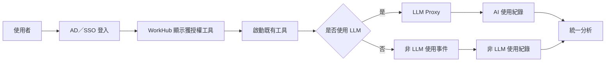
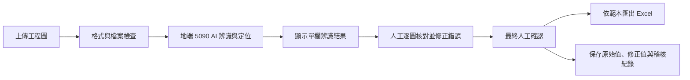

> 歷史文件：自 2026/10/08 起，現行需求以 [PRD v0.18](PRD.md) 為準；下文保留追溯，不作現行日期、範圍或驗收承諾。

# 企業 AI Agent 統一管理平台 Phase 1 PRD

> 文件版本：v0.16（草案）  
> 文件日期：2026/09/08  
> 建置期間：原目標 2026/09/01–2026/10/30；依完整平台範圍重新估算  
> 文件狀態：待需求訪談與客戶確認

## 1. 產品摘要

WorkHub 是開放上架的企業工具平台，不以現有工具清單、類型或數量作為平台上限。符合接入與上架規範的工具可持續加入，由客戶 AI 團隊自主維護。Phase 1 由專案團隊完成平台、1–2 個工具的完整試點及技術移轉，後續工具由客戶自行上架。使用 LLM 的工具可由後台個別切換核准的地端／雲端模型，統一經 LLM Proxy（Gateway）管理。既有 OpenWebUI 入口及 AI 識圖專項需求持續適用；是否納入試點名單由雙方確認。

本 PRD 是設計、開發、測試與驗收依據；正式決策見 `DECISIONS.md`。Proposal、會議記錄、README 與 <http://localhost:3002/> Demo 僅作背景或 UI／流程參考。

## 2. 產品目標與成功指標

### 2.1 產品目標

1. 建立不限定工具清單、類型與數量的開放上架平台，保留工具原有業務功能。
2. 以 AD／SSO 與角色權限提供一致且可管理的工具入口。
3. 透過 LLM Proxy、非 LLM 使用事件及主管分析建立工具治理基礎。
4. 於地端 NVIDIA RTX 5090 運算環境完成 AI 識圖的辨識、人工覆核、成功率驗證、追溯與 Excel 匯出流程。
5. 完成 1–2 個工具的完整試點與技術移轉，使客戶 AI 團隊能自行上架、更新、下架及管理後續工具。
6. 每個使用 LLM 的工具均能透過後台設定地端／核准雲端模型、版本與配額，切換相容模型不需修改工具程式。

### 2.2 成功指標

| 指標 | Phase 1 定義 | 目標／門檻 |
|---|---|---|
| 授權正確性 | 使用者只能看到並開啟獲授權工具 | UAT 不得出現越權案例 |
| 試點全流程完成 | 雙方選定 1–2 個工具，完成提交、AI 檢查、測試、上架、授權、使用、更新及版本回復 | 所有選定試點通過完整流程驗收 |
| 自主管理與技術移轉 | 客戶 AI 團隊依交付文件自行上架新工具、設定權限及適用的 LLM 路由 | 不修改平台程式碼，完成客戶親自操作的上架演練 |
| 工具使用數據記錄完整性 | 核准上線的 LLM 與非 LLM 工具由 WorkHub 點選啟動時均須保存使用資料；LLM 工具另記錄模型使用資料，非 LLM 工具至少記錄啟動、完成及錯誤事件 | XX% 從 WorkHub 點選啟動的 LLM 與非 LLM 使用行為有可查詢紀錄，且完成與失敗可明確區分 |
| 工具成效分析可用性 | 主管可依期間、部門及工具查看使用次數、趨勢與核准的成效資訊 | 核准上線工具均可查看基礎使用分析；各工具成效指標、公式與門檻待確認 |
| 品保校對效率 | 品保使用 AI 識圖完成同類工程圖校對所需時間，相較現行人工校對基準 | 平均校對時間縮短 50% |
| 品保使用滿意度 | 完成 AI 識圖試用／UAT 的品保人員中，問卷回覆滿意或非常滿意的比例 | 高於 80% |

> **備註（工具使用數據範圍）**：Phase 1 僅記錄使用者從 WorkHub 點選並啟動工具的行為。使用者從瀏覽器書籤、直接輸入 URL 或其他外部入口進入工具時，WorkHub 無法產生啟動紀錄，因此不納入工具使用數據記錄完整性的計算分母及主管分析。
>
> **備註（AI 識圖量測）**：AI 識圖項目正確率可在模型測試／驗收資料中標示核准目標與實測結果，但不列為 Phase 1 產品成功指標。若日後要納入正式成功指標，須另行評估標準答案建置、資料標註、測試執行、報表開發與持續維運成本。AI 識圖人工修正率及模型處理時間亦不列為 Phase 1 產品成功指標；本期以品保校對時間及使用滿意度衡量產品成果。

## 3. 使用者與角色

Phase 1 最多 100 位使用者；AI 識圖涵蓋基隆 2 廠、汐止 2 廠及越南 3 廠。實際名單、同時在線量與權限對應待確認。

| 角色 | 主要需求 | Phase 1 權限方向 |
|---|---|---|
| 一般使用者 | 使用工作所需工具 | 查看與啟動獲授權工具 |
| 品檢員 | 執行並覆核 AI 識圖 | 上傳、修正、確認及匯出 |
| 主管 | 了解部門採用與效益 | 查看授權範圍的彙總分析 |
| IT／平台管理員 | 管理平台 | 管理目錄、權限及設定 |
| 客戶 AI 團隊／內部開發者 | 自主管理與持續上架 | 依授權提交、測試、發布、更新、回復版本及設定工具與模型 |
| 資安／稽核人員 | 稽核資料與模型流向 | 依授權查閱政策與事件紀錄 |

正式 AD 群組、角色命名、跨部門權限及代理規則見附件 `01-工具與權限盤點.md`。

## 4. Phase 1 範圍

| 納入 Phase 1 | 不納入 Phase 1 |
|---|---|
| WorkHub 工具中心、搜尋、分類與篩選 | 重做既有工具或 OpenWebUI 的 UI、Backend、Prompt 功能 |
| AD／SSO、角色與工具權限 | OpenWebUI 知識庫權限與自動選擇整合 |
| 開放上架、1–2 個工具完整試點、自主管理後台與技術移轉 | Skill、MCP、快查 |
| Container 託管、AI 程式碼檢查、自動建置、測試、發布／回復及工具治理 | 未經確認的既有工具業務功能重製 |
| OpenWebUI 授權入口與 URL 導流；單一共用 URL 或各部門不同 URL 待決策 | 書籤／URL 直連的完整紀錄補強 |
| LLM Proxy、非 LLM 使用事件與主管分析 | ERP、CRM 或其他正式系統寫回 |
| AI 識圖與 Excel 匯出；測試、UAT 及交接 |  |

既有工具盤點移至附件 `01-工具與權限盤點.md`，作為試點選擇與後續上架參考，不構成平台類型／數量限制或由專案團隊逐項代上架的承諾。平台以接入規範管理工具，支援符合規範的不同語言與框架；實際執行量依資源與核准容量管理。非網頁或特殊執行需求依例外接入評估處理。現有 WorkHub 僅為 Demo，驗收以正式環境與 UAT 證據為準。

## 5. 使用流程與介面

### 5.1 一般工具流程

### 5.2 AI 識圖流程

### 5.3 介面原則

- 登入後直接進入工具中心；分類、搜尋及篩選延續 Demo 方向。
- AI 識圖以大圖檢視、定位與快速修正為主，畫面只顯示目前結果。
- AI 原始值於後端保存；正確項目不需逐筆確認，但匯出前須整體確認。

## 6. 功能需求

### 6.1 WorkHub 統一入口

| ID | 需求 | 驗收重點 |
|---|---|---|
| P1-PORTAL-001 | 使用者登入後只看到其部門、職務或角色獲授權的工具。 | 使用不同角色帳號驗證可見清單，無越權工具。 |
| P1-PORTAL-002 | 使用者可依全公司／部門分類篩選工具。 | 篩選結果與工具設定及使用者權限一致，無結果時有明確空狀態。 |
| P1-PORTAL-003 | 使用者可依工具名稱與用途關鍵字搜尋。 | 搜尋名稱或描述均能取得正確結果。 |
| P1-PORTAL-004 | 有權限的工具可直接啟動，並保留原工具 UI 與流程。 | 啟動目標、登入狀態與權限符合工具設定。 |
| P1-PORTAL-005 | 無權限、停用、維護或失效工具不可正常啟動，並顯示可理解訊息。 | 各狀態均有阻擋及事件紀錄。 |
| P1-PORTAL-006 | 正式工具名稱、分類、Owner、入口與狀態由平台資料管理，不寫死於前端。 | 管理資料異動後，前端依正式資料呈現。 |

### 6.2 AD／SSO 與權限

| ID | 需求 | 驗收重點 |
|---|---|---|
| P1-AUTH-001 | 使用者透過公司核准的 AD／SSO 登入。 | 正常、失敗、逾時及登出流程均可驗證。 |
| P1-AUTH-002 | 平台取得穩定的使用者識別、部門及角色資訊。 | 欄位缺漏或不合法時拒絕授權並記錄原因。 |
| P1-AUTH-003 | AD 群組對應平台角色與工具權限。 | 權限矩陣中的允許與拒絕案例全部一致。 |
| P1-AUTH-004 | 帳號停用或權限移除後不得繼續取得受保護功能。 | 依確認的同步頻率完成停權測試。 |
| P1-AUTH-005 | 主管僅查看其獲授權範圍的彙總分析。 | 跨部門與非主管帳號不得查看未授權資料。 |
| P1-AUTH-006 | 權限判斷須由後端執行，不以隱藏前端元件作為唯一保護。 | 直接呼叫受保護介面亦會被拒絕。 |

### 6.3 既有工具整合

| ID | 需求 | 驗收重點 |
|---|---|---|
| P1-TOOL-001 | 每個納入工具均完成名稱、部門、URL、環境、Owner、使用角色及 LLM 分類登錄；LLM 分類至少區分雲端 LLM、Local LLM、可能使用 LLM 及非 LLM。 | 工具盤點表必要欄位完整，分類與正式資料流證據一致。 |
| P1-TOOL-002 | 平台啟動工具時傳遞或建立可驗證的使用者身分。 | 工具端無法僅靠偽造前端參數取得權限。 |
| P1-TOOL-003 | 使用 LLM 的工具後端改接 LLM Proxy，不直接連接未核准模型端點。 | 網路或設定檢查證明正式流量經 Proxy。 |
| P1-TOOL-004 | 未使用 LLM 的工具至少回報啟動、完成及錯誤事件。 | 三類事件可在分析資料來源查詢。 |
| P1-TOOL-005 | 專案團隊完成雙方選定的 1–2 個工具全流程試點，交付接入範本與技術移轉，後續由客戶 AI 團隊自行上架。 | 試點入口、授權、紀錄及更新／回復通過；客戶可依文件完成新工具上架，既有業務功能正常。 |
| P1-TOOL-006 | WorkHub 依使用者權限顯示 OpenWebUI 入口，啟動時導向工具目錄設定的 OpenWebUI URL；Phase 1 不重做其原有介面與功能。是否依部門導向不同 URL 由 `TBD-OPENWEBUI-001` 決定，未決前不視為已承諾的 Phase 1 範圍。 | 有權限者可由 WorkHub 進入正確 URL；無權限、停用或 URL 失效時依平台規則阻擋或提示。若核准分部門 URL，另驗證部門對應、跨部門拒絕及未設定 URL。 |
| P1-TOOL-007 | 標示為「可能使用 LLM」的工具，須在整合設計前確認實際 AI 元件與資料流；確認使用 LLM 時遵循 P1-TOOL-003，確認未使用 LLM 時遵循 P1-TOOL-004。 | 以設定、程式介面或網路流量證據完成分類；不得在分類未確認時跳過 Proxy 或非 LLM 使用事件要求。 |
| P1-TOOL-008 | 平台開放上架，不將工具名稱、類型或數量清單寫死為允許條件；符合容器、身分、網路、事件及模型接入規範的工具可由後台登錄。 | 新增盤點清單以外的工具不需修改平台程式；新增工具受相同權限與資料政策管理。 |

### 6.4 LLM Proxy 與資料治理

| ID | 需求 | 驗收重點 |
|---|---|---|
| P1-LLM-001 | LLM Proxy 依核准政策路由至地端或核准雲端模型。 | 以不同資料等級案例驗證路由結果。 |
| P1-LLM-002 | 禁止上雲的資料不得被導向雲端模型或未核准端點。 | 敏感圖面與附件案例均被地端處理或阻擋。 |
| P1-LLM-003 | Proxy 記錄工具、模型、Token、路由、回應時間、結果與錯誤。 | 稽核事件可依執行識別碼追溯。 |
| P1-LLM-004 | Proxy 支援工具或使用者適用的配額政策。 | 超額時有一致錯誤回應及紀錄。 |
| P1-LLM-005 | 逾時、重試及故障切換遵循資料政策，不得因備援而繞過禁止上雲規則。 | 故障情境測試不發生政策降級。 |
| P1-LLM-006 | Prompt、附件與輸出全文是否保存，依核准的最小化與留存政策執行。 | 正式資料庫欄位與存取權符合政策。 |
| P1-LLM-007 | 客戶 AI 團隊可在後台逐工具設定地端／雲端模型、版本與配額，並新增核准端點；相容模型間切換不需修改工具程式。 | 使用核准測試資料切換地端與雲端，路由、版本、配額與紀錄正確；未授權設定與禁止上雲的切換被拒絕。 |

模型切換適用於使用 LLM 的工具；非 LLM 工具不需設定模型。選擇範圍須符合工具能力與資料政策，平台不因提供切換功能而放寬禁止上雲規則。AI 識圖目前仍依 P1-VIS-015 使用地端 RTX 5090。

### 6.5 使用紀錄與主管分析

| ID | 需求 | 驗收重點 |
|---|---|---|
| P1-OBS-001 | 由 WorkHub 點選啟動的 LLM 與非 LLM 工具紀錄使用一致的工具及執行識別方式。書籤、直接 URL 或其他外部入口不屬於 Phase 1 WorkHub 記錄範圍。 | 從 WorkHub 啟動的同一工具執行可跨來源追溯且不重複計算；外部入口不被誤計入完整性分母。 |
| P1-OBS-002 | 系統至少區分啟動、完成與錯誤事件。 | 儀表板數值可回溯至原始事件。 |
| P1-OBS-003 | 主管儀表板顯示活躍使用者、工具執行次數及使用趨勢。 | 期間、部門及工具篩選結果正確。 |
| P1-OBS-004 | 儀表板顯示 AI／非 AI 分布，以及 AI 模型、Token 與地端／雲端比例。 | 彙總值與 Proxy／事件來源抽查一致。 |
| P1-OBS-005 | 主管不查看員工完整 Prompt、附件或回應內容。 | UI 與分析 API 均不回傳未授權全文。 |
| P1-OBS-006 | 指標定義、分母、時區及更新頻率可被查證。 | 相同資料重算可得到一致結果。 |
| P1-OBS-007 | 失敗或不完整事件不被誤計為完成。 | 中斷、逾時及重複送出案例計算正確。 |

### 6.6 AI 識圖

| ID | 需求 | 驗收重點 |
|---|---|---|
| P1-VIS-001 | 使用者可上傳核准格式及大小的工程圖；不合法檔案須在處理前被拒絕。 | 格式、大小、頁數、加密與損壞檔案均有測試。 |
| P1-VIS-002 | 系統建立可追蹤的識圖工作，狀態至少涵蓋上傳、處理、待覆核、已確認、已匯出及失敗。 | 重新整理後仍能取得正確狀態，狀態轉換不可跳過必要確認。 |
| P1-VIS-003 | 系統辨識球標／檢點、規格、數值、公差、文字註記及圖面位置。 | 以核准標準答案逐項比較。 |
| P1-VIS-004 | 圖面支援放大、縮小及檢點定位，使用者選擇結果時能看到對應區域。 | 大圖及兩頁圖面均可定位且文字仍可閱讀。 |
| P1-VIS-005 | 右側顯示單一目前結果，不並列 AI 與人工兩組值。 | 畫面符合 Demo 方向；後端仍保存兩者。 |
| P1-VIS-006 | 使用者可在圖面附近或結果列直接修正錯誤值。 | 修改後立即反映目前結果並保留修正紀錄。 |
| P1-VIS-007 | 正確項目不需逐筆點選，匯出前必須完成一次明確的整體人工確認。 | 未完成最終確認不得匯出。 |
| P1-VIS-008 | 系統分別保存 AI 原始值與人工修正值，不得覆寫原始值。 | 可依工作、項目、使用者及時間追溯差異。 |
| P1-VIS-010 | 系統依客戶確認的既定格式匯出 Excel。 | 以核准的範本版本、欄位及代表性資料驗證。 |
| P1-VIS-011 | 正式辨識欄位、判定及匯出規則須由品保確認後實作。 | 系統結果與核准規則逐項一致。 |
| P1-VIS-012 | 處理失敗時保留可理解的錯誤原因及安全重試方式，不產生半完成匯出。 | 逾時、模型錯誤及輸出不完整案例可恢復。 |
| P1-VIS-013 | 系統可由 AI 原始值、人工最終值與標準答案計算項目正確率及修正率。 | 指標可由保存資料重算並取得一致結果。 |
| P1-VIS-014 | 原圖、局部截圖、辨識值、修正值與匯出檔依核准留存及刪除政策處理。 | 到期刪除、權限及稽核測試符合政策。 |
| P1-VIS-015 | AI 識圖模型須於地端 NVIDIA RTX 5090 運算環境執行；辨識成功率測試亦須使用相同地端環境，且不得因錯誤或備援將圖面或推論資料送往未核准雲端。 | 在正式／驗收環境核對 GPU、模型端點與網路路由；以核准測試集執行辨識並保存硬體、模型版本、推論設定、樣本數、原始結果及成功率報告。 |

### 6.7 自主管理、上架與更新

| ID | 需求 | 驗收重點 |
|---|---|---|
| P1-ADMIN-001 | 客戶 AI 團隊由後台管理工具上下架、說明、URL、Owner、部門／個人權限及模型設定；設定變更生效並保留紀錄。 | 不修改平台程式碼即可新增、修改、停用工具與設定；未授權者不可操作。 |
| P1-DEPLOY-001 | 提供工具 Container 託管、接入範本與自動建置；申報資源、網路及 Owner，資料保存於容器外。 | 依文件完成建置部署；容器重建後資料仍在，資源及網路限制可驗證。 |
| P1-RELEASE-001 | 程式更新經提交、AI 程式碼檢查、修正與確認、測試、發布及必要時版本回復；依風險採完整或簡化流程。 | 保留檢查及版本證據；禁止直接上傳正式環境；客戶親自完成更新與回復。 |
| P1-GOV-001 | 工具 Owner 可透過工具管理頁更新資料，由容器內程式處理；程式更新走發布流程。 | 更新資料不需在個人電腦執行程式，權限、錯誤與更新結果可查證。 |

AI 檢查對象為程式、設定與相依套件，須提供可檢查資料；阻斷問題須修正並確認後才可發布。image／已知漏洞檢查與 AI 檢查分開記錄。技術移轉包含接入範本、管理設定、AI 檢查、測試、部署及回復操作。

## 7. 資料、安全與非功能需求

核心資料涵蓋使用者與權限、工具目錄、使用事件、LLM 紀錄及 AI 識圖工作；詳細欄位見附件 `02-事件與LLM-Proxy規格.md` 與 `03-AI識圖規格.md`。

- 採最小權限、後端授權及必要資料最小化原則。
- 敏感圖面、附件及客戶資料不得因模型故障或備援自動送往未核准雲端。
- 管理與敏感紀錄依角色限制並保留稽核；Secret、Token 不得進入前端、版本庫或一般 Log。
- 保存、遮罩、加密、備份及刪除政策由 IT／資安確認。

| 項目 | 要求 | 狀態 |
|---|---|---|
| 使用規模 | 最多 100 位 Phase 1 使用者 | 已確認 |
| 容量與效能 | 同時在線、工具中心、分析及 AI 識圖門檻 | 待確認 |
| 可用性與復原 | 服務時間、維護窗口、可用性及 RTO／RPO | 待確認 |
| 備援 | LLM 與平台故障處理不得降低資料政策 | 原則確認；RTO／RPO 待定 |
| 相容性與語言 | 公司桌面瀏覽器、手機及越南廠語言需求 | 待確認 |
| 監控 | 登入、工具、Proxy、事件、識圖與匯出失敗可告警 | 門檻待確認 |

## 8. 驗收與上線

### 8.1 試點、技術移轉與後續上架

1. 雙方選定 1–2 個工具，由專案團隊跑通提交、AI 檢查、修正、測試、上架、授權、使用、更新及版本回復，關閉試點問題。
2. 交付文件與接入範本並完成技術移轉，由客戶 AI 團隊親自完成上架操作；模型切換使用核准測試資料驗證。
3. 客戶依自身優先序自行上架其他工具，專案交接包含支援窗口與使用者教育訓練。

### 8.2 客戶實作驗收與交付

| 驗收底線 | 通過條件 |
|---|---|
| 自主上架 | AI 團隊不修改平台程式，完成新工具上架、權限及適用的 LLM 切換 |
| 自行建置 | 內部開發者依文件實際建置並部署平台 |
| 備份還原 | 模擬故障，還原工具資料並確認可使用 |
| 開發者流程 | 親自完成提交、AI 檢查、測試、上架、更新及版本回復 |
| 員工流程 | 親自完成登入、找到工具、申請權限、使用及回報問題 |

交付完整平台原始碼、部署檔、資料庫結構與移轉方式、環境權限、架構與建置說明、操作維運文件、教材及演練證據。智慧財產、保固、SLA、維護費用、資安窗口及改版責任由合約確認。平台能力的驗收以實際演練為準，後續工具逐項代上架不列為本次交付條件。

### 8.3 驗收原則

- 驗收依本 PRD、核准附件、正式環境及 UAT 證據執行。
- 需求編號須能對應至少一個 UAT、整合測試或安全測試。
- 越權、敏感資料未授權上雲、AI 原始值被覆寫或未確認即可匯出，均為阻斷上線缺陷。
- 測試涵蓋身分權限、工具串接、Proxy／事件、分析、AI 識圖、核准負載及安全復原。
- 上線前完成 UAT、阻斷缺陷關閉、教材、維運文件與支援窗口確認；詳見附件 `04-UAT與需求追蹤.md`。

## 9. 待確認事項與風險

| ID | 決策事項 | Owner | 最晚完成 | 未完成影響 |
|---|---|---|---|---|
| TBD-PILOT-001 | 選定 1–2 個試點、適用模型、工具改造責任與客戶技術移轉人員；確認 AI 識圖／OpenWebUI 是否作為試點 | 客戶 AI 團隊／專案團隊 | 試點開發前 | 無法確定試點工作量與演練安排；既有專項需求持續適用 |
| TBD-AUTH-001 | AD／SSO 協定、群組、角色及同步方式 | Tammy | 開發前 | 無法完成登入與權限 |
| TBD-LLM-001 | LLM Proxy 現況、API、模型、部署與維運 Owner，以及雲端／Local LLM 工具逐項的正式端點與 Proxy 路徑 | 顧問 | 開發前 | 無法串接 LLM 工具、驗證資料路由與完成稽核 |
| TBD-DATA-001 | 禁止上雲資料及 Prompt／附件／輸出保存政策 | 資安 | 開發前 | 無法完成路由與資料設計 |
| TBD-OPENWEBUI-001 | OpenWebUI 在 Phase 1 使用單一共用 URL，或依部門導向不同 URL；分部門 URL 是否延至 Phase 2 | Tammy | 工具整合設計凍結前 | 若分部門 URL 納入 Phase 1，需增加部門對應、權限、設定及 UAT，時程增加 1 週；上線日預計由 2026/10/30 調整為 2026/11/06，仍須正式核准 |
| TBD-VIS-001 | 正式辨識欄位、標準答案、地端 5090 測試所用模型版本與推論設定、成功率公式及門檻 | 顧問 | 模型驗證前 | 無法重現測試或判定 AI 識圖是否通過 |
| TBD-VIS-002 | Excel 正式欄位、格式、判定及簽核規則 | 品保 | 匯出開發前 | 無法完成正式匯出 |
| TBD-NFR-001 | 同時在線、回應時間、可用性、RTO／RPO | IT／專案團隊 | 效能設計前 | 無法設計容量與驗收 |
| TBD-KPI-001 | 品保現行校對時間基準、同類圖面抽樣方式、滿意度問卷題目及有效樣本規則 | 品保 | UAT 前 | 無法一致計算校對時間是否縮短 50% 及滿意度是否高於 80% |
| TBD-KPI-002 | 各核准工具的成效指標、資料來源、計算公式、目標門檻與 Owner | Tammy | 主管分析設計凍結前 | 只能提供使用次數與趨勢，無法判定工具實際成效 |
| TBD-UAT-001 | UAT 人員、通過門檻、驗收人與緩衝期 | Tammy | UAT 前 | 無法完成正式驗收 |

主要風險為外部介面／決策延遲壓縮 UAT、既有工具驗證方式不一，以及 AI 識圖樣本不足。完整決策紀錄見 `DECISIONS.md`。

## 附件

- [決策紀錄](DECISIONS.md)
- [工具與權限盤點](attachments/01-工具與權限盤點.md)
- [事件與 LLM Proxy 規格](attachments/02-事件與LLM-Proxy規格.md)
- [AI 識圖規格](attachments/03-AI識圖規格.md)
- [UAT 與需求追蹤](attachments/04-UAT與需求追蹤.md)
