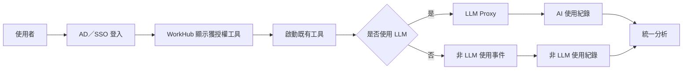
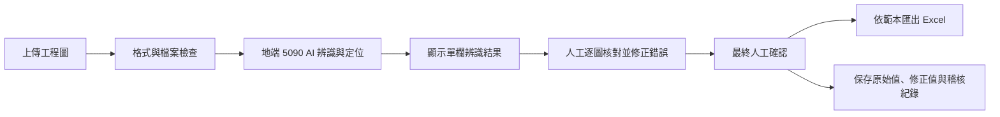

> 歷史文件：自 2026/10/08 起，現行需求以 [PRD v0.18](PRD.md) 為準；下文保留追溯，不作現行日期、範圍或驗收承諾。

# 企業 AI Agent 統一管理平台 Phase 1 PRD

> **2026-09-11 識圖交接範圍更新（以此為準）**：依使用者本次確認，AI 識圖改為未完成版本的獨立前端原始碼交接；本次不部署、不上傳 GitHub、不串接 5090，也不完成剩餘功能。WorkHub 移除內嵌識圖介面，只保留工具資訊、入口可見性與可選 URL；未設定 URL 時顯示「待設定入口」。後續辨識、後端保存、登入／權限、GPU 驗證、部署與正式 UAT 由客戶接手。现有前端部門篩選不代表已完成 AD／後端權限。本文下方涉及舊識圖建置承諾、5090 驗收或完整識圖 UAT 的敘述保留作歷史／後續需求，不屬於本次交付完成條件。範例逐筆確認與舊「整體確認」不同，交接保留目前行為，未替客戶決定正式流程。

> 文件版本：v0.17  
> 文件日期：2026/09/08  
> 原目標期間：2026/09/01–2026/10/30；依核准範圍、可投入時數與客戶配合時點重估  
> 合作方式：依現行時數合約及約定時薪執行  
> 本輪僅更新 PRD；決策紀錄與附件待本版確認後同步，內容衝突以本版待評審內容標示為準

## 1. 產品目的與成功條件

WorkHub 整合公司分散的工具，提供統一入口、權限、部署、模型接入及使用分析。平台不預測未來有哪些工具，也不以現有清單、業務類型、開發語言或固定數量限制上架；符合工具上架標準並通過接入驗證的工具，可由客戶 AI 團隊持續上架。

本期完成平台、1–2 個工具試點與技術移轉，另行建置 AI 識圖。使用 LLM 的工具可由後台切換相容且核准的地端／雲端模型；模型切換遵守資料政策，不代表各模型輸出品質相同。

| 成功條件 | 驗收／量測方式 |
|---|---|
| 授權正確 | UAT 無越權案例；平台與工具端均驗證權限 |
| 試點全流程完成 | 雙方選定的 1–2 個工具完成上架、使用、更新及回復；AI 識圖不計入 |
| 自主管理與技術移轉 | 客戶依文件完成新工具上架及設定，不需修改平台程式 |
| 工具入口點擊紀錄 | 可在管理後台查看從 WorkHub 點選工具的紀錄與次數；平台不判定工具是否成功啟動或完成工作。書籤或直接工具網址不納入紀錄。 |
| 工具成效分析可用性 | 可依期間、部門與工具查詢使用及模型彙總；業務效益以客戶核准資料與公式計算 |
| 品保校對效率 | 同類圖面平均校對時間較人工基準縮短 xx%（目標待確認） |
| 品保使用滿意度 | 有效問卷中滿意／非常滿意比例高於 80% |

Phase 1 的工具入口點擊次數，以通過平台權限與入口狀態檢查後的點選計算，即使後續工具未成功開啟仍保留該次點擊。書籤、直接工具 URL 或其他外部入口無法記錄，不納入點擊統計及主管分析。權限或入口狀態阻擋另留事件紀錄，不計為有效入口點擊。

需求依本次使用者確認、客戶《AI Agent 工具平台 — 需求說明與架構》及已同步的決策整理。Proposal、歷史會議、README 與 localhost:3002 Demo 僅作背景或 UI 參考。

## 2. Phase 1 範圍與責任

### 2.1 專案時間

| 項目 | 日期／安排 |
|---|---|
| 需求準備 | 2026/09/01 起進行 PRD、工具盤點與需求確認 |
| 建置期間 | 2026/09/01–2026/10/30 |
| 平台與試點 | 需求／接入確認 → 平台建置 → 1–2 個工具試點 → 客戶實作驗收與技術移轉 |
| AI 識圖 | 品保訪談／範本確認 → 地端模型測試與功能建置 → 品保驗收；可與平台工作重疊進行 |
| 後續上架 | 技術移轉後，由客戶 AI 團隊自行安排其他工具上架 |

各階段起迄日及里程碑在本版需求確認後排定；2026/10/30 為原目標日，不代表新範圍已完成估期。

### 2.2 範圍與責任

| 工作 | 顧問／專案團隊交付 | 客戶配合與後續責任 |
|---|---|---|
| 平台 | 工具入口、身分權限、自主管理後台、容器部署、LLM Proxy（模型統一入口）、紀錄分析、發布治理與維運能力 | IT 提供身分介面、主機／網路、政策；AI 團隊承接平台日常操作 |
| 1–2 個工具試點 | 選定工具的必要接入改造、完整流程驗證及技術移轉 | 提供程式、環境、Owner 與測試資料；後續自行改造及上架其他工具 |
| AI 識圖 | 另外建置地端 RTX 5090 辨識、人工校對、確認及 Excel 匯出，獨立估時與驗收，不占試點名額 | 品保提供訪談、正式欄位、範本、標準答案與驗收人員 |
| OpenWebUI | 授權入口、URL 導流及適用的標準接入 | 提供正式環境；是否作為試點、共用或分部門 URL 待確認 |
| 技術移轉 | 平台建置、工具接入、發布、回復、備份及管理教材與實作訓練 | 指定具備開發／維運能力的承接人員並完成演練 |

原工具業務功能保留，允許容器化、SSO、LLM Proxy 與事件接入所需改造。工具盤點僅供選擇試點與後續上架，不構成全清單代上架承諾。特殊環境或新接入協定須先評估；開放數量不代表無限運算、儲存或維護時數。

OpenWebUI 知識庫深度整合、平台 Prompt／Skill／MCP 功能、ERP／CRM 寫回及桌面 Excel／CAD 外掛不屬本期交付。公司個人電腦開發環境管理與影子工具遷移政策由客戶制定；後續工具遷移由客戶 AI 團隊安排。

## 3. 主要流程與角色

## 3. 使用流程與介面

### 3.1 一般工具流程

### 3.2 AI 識圖流程

### 3.2 角色與主要流程

| 角色 | 主要操作與責任 |
|---|---|
| 一般員工 | 使用獲授權工具、申請權限、回報問題 |
| 品檢員 | 執行 AI 識圖、校對、確認與匯出 |
| 主管 | 查看授權範圍的使用與效益彙總，不查看員工完整 Prompt／附件／回應 |
| 客戶 AI 團隊／平台管理員 | 管理工具與模型設定、最終授權、上下架與平台問題 |
| 內部開發者／工具 Owner | 提交與修正工具、更新資料、處理內容問題及生命週期 |
| IT／資安 | 身分與設備、資料政策、備份與資安窗口；依職責授權 |

- 員工：公司身分登入 → 搜尋／找工具 → 必要時申請權限 → 使用 → 回報問題。未授權工具的功能與資料保持封鎖；是否顯示可申請的公開工具摘要待 UI 規格確認。
- 工具接入：WorkHub 後端記錄入口點擊並傳遞可信身分 → 工具驗證後免重複登入；使用 LLM 時，模型呼叫另經 LLM Proxy 記錄。平台不追蹤一般工具的啟動或工作完成結果。
- AI 識圖：上傳檢查 → 地端辨識 → 圖面定位及人工修正 → 整體確認 → Excel 匯出，原始值與修正值分開保存。
- 工具管理：依第 5 章上架及更新；平台授權與工具端驗證共同生效。

AI 識圖涵蓋基隆、汐止及越南廠區；名單、語言與網路需求由客戶確認。容量需求列於第 7 章待確認事項。

## 4. 功能與工具上架標準

### 4.1 工具上架標準

| 標準 | 最低要求 |
|---|---|
| 容器化交付 | Docker image 包含工具與仍受維護的執行環境，符合平台作業系統／架構；原始碼提交須附建置設定，平台自動建置 image |
| 瀏覽器操作 | 提供可透過 URL 使用的網頁服務 |
| 平台身分整合 | 接受並驗證平台身分，免重複登入，不以可偽造的前端參數授權 |
| 統一模型接入 | 使用 LLM 時統一經 LLM Proxy；模型憑證集中管理；非 LLM 工具不適用模型設定 |
| 資源與責任登錄 | 申告 CPU／記憶體／GPU、必要網路連線及 Owner；未申告連線預設禁止，資源依核准配置 |

任何符合五項標準並通過接入及安全檢查的工具均可上架。平台接入附件規定健康檢查、事件、儲存及建置資料等細節；不要求所有工具共用語言或業務格式。排程服務保留擴充設計，非網頁及特殊依賴走例外評估，具體接入工作先確認。

### 4.2 WorkHub 統一入口

| ID | 需求 | 驗收重點 |
|---|---|---|
| P1-PORTAL-001 | 使用者登入後只看到其部門、職務或角色獲授權的工具。 | 使用不同角色帳號驗證可見清單，無越權工具。 |
| P1-PORTAL-002 | 使用者可依全公司／部門、功能及 AI／一般工具分類篩選工具。 | 篩選結果與工具設定及使用者權限一致，無結果時有明確空狀態。 |
| P1-PORTAL-003 | 使用者可依工具名稱與用途關鍵字搜尋。 | 搜尋名稱或描述均能取得正確結果。 |
| P1-PORTAL-004 | 有權限的工具可直接啟動，並保留原工具 UI 與流程。 | 啟動目標、登入狀態與權限符合工具設定。 |
| P1-PORTAL-005 | 無權限、停用、維護或失效工具不可正常啟動，並顯示可理解訊息。 | 各狀態均有阻擋及事件紀錄。 |
| P1-PORTAL-006 | 正式工具名稱、分類、Owner、入口與狀態由平台資料管理，不寫死於前端。 | 管理資料異動後，前端依正式資料呈現。 |
| P1-PORTAL-007 | 提供常用紀錄、用途／對象／資料限制／操作說明及適用地端／雲端模型標示。 | 常用紀錄與入口點擊紀錄一致；工具說明與目前核准路由一致。 |
| P1-PORTAL-008 | 平台提供權限申請、通知及問題回報功能。 | 員工可申請工具權限，管理者可收到通知；員工可回報問題至指定窗口。 |

### 4.3 AD／SSO 與權限

| ID | 需求 | 驗收重點 |
|---|---|---|
| P1-AUTH-001 | 使用者透過公司核准的 AD／SSO 登入。 | 正常、失敗、逾時及登出流程均可驗證。 |
| P1-AUTH-002 | 平台取得穩定的使用者識別、部門及角色資訊。 | 欄位缺漏或不合法時拒絕授權並記錄原因。 |
| P1-AUTH-003 | AD 群組對應平台角色，支援部門及指定個人工具授權，異動保留紀錄。 | 權限矩陣中的允許與拒絕案例全部一致。 |
| P1-AUTH-004 | 帳號停用或權限移除後不得繼續取得受保護功能。 | 依確認的同步頻率完成停權測試。 |
| P1-AUTH-005 | 主管僅查看其獲授權範圍的彙總分析。 | 跨部門與非主管帳號不得查看未授權資料。 |
| P1-AUTH-006 | 權限判斷須由後端執行，不以隱藏前端元件作為唯一保護。 | 直接呼叫受保護介面亦會被拒絕。 |
| P1-AUTH-007 | 平台與工具端驗證可信身分；個人例外權限、停權及既有登入失效遵循核准同步規則。 | 偽造身分、過期登入及已撤銷授權不可取得受保護功能。 |

### 4.4 既有工具整合

| ID | 需求 | 驗收重點 |
|---|---|---|
| P1-TOOL-001 | 每個工具登錄名稱、部門、URL、環境、Owner、使用角色、資源與網路需求，以及是否使用 LLM 和核准模型路由；分類可擴充。 | 以與客戶討論確認的 1–2 個試點工具進行驗收，確認各工具登錄資料完整且正確。 |
| P1-TOOL-002 | 平台啟動工具時傳遞可驗證身分；接入工具驗證後免再次登入。 | 工具端無法僅靠偽造前端參數取得權限。 |
| P1-TOOL-003 | 使用 LLM 的工具後端改接 LLM Proxy，統一經 LLM Proxy 呼叫模型，不自行持有模型 API Key 或繞過 LLM Proxy 直連模型。 | 網路或設定檢查證明正式流量經 Proxy。 |
| P1-TOOL-004 | 非 LLM 工具由 WorkHub 後端記錄入口點擊，不經 LLM Proxy，也不要求工具回報啟動、完成或失敗結果。 | 管理後台可查詢入口點擊；工具未成功開啟仍保留點擊，不顯示工具執行結果。 |
| P1-TOOL-005 | 專案團隊完成雙方選定的 1–2 個工具全流程試點，交付接入範本與技術移轉，後續由客戶 AI 團隊自行上架。 | 試點入口、授權、紀錄及更新／回復通過；客戶可依文件完成新工具上架，既有業務功能正常。 |
| P1-TOOL-006 | WorkHub 依使用者權限顯示 OpenWebUI 入口，啟動時導向工具目錄設定的 OpenWebUI URL；Phase 1 不重做其原有介面與功能。是否依部門導向不同 URL 由 `TBD-OPENWEBUI-001` 決定，未決前不視為已承諾的 Phase 1 範圍。 | 有權限者可由 WorkHub 進入正確 URL；無權限、停用或 URL 失效時依平台規則阻擋或提示。若核准分部門 URL，另驗證部門對應、跨部門拒絕及未設定 URL。 |
| P1-TOOL-007 | 標示為「可能使用 LLM」的工具，須在整合設計前確認實際 AI 元件與資料流；確認使用 LLM 時遵循 P1-TOOL-003，確認未使用 LLM 時遵循 P1-TOOL-004。 | 以設定、程式介面或網路流量證據完成分類；不得在分類未確認時跳過 Proxy 或非 LLM 使用事件要求。 |
| P1-TOOL-008 | 平台開放上架，不將工具名稱、類型或數量清單寫死為允許條件；符合容器、身分、網路、事件及模型接入規範的工具可由後台登錄。 | 新增盤點清單以外的工具不需修改平台程式；新增工具受相同權限與資料政策管理。 |

### 4.5 LLM Proxy 與資料治理

| ID | 需求 | 驗收重點 |
|---|---|---|
| P1-LLM-001 | LLM Proxy 依客戶管理者為各工具設定的模型端點，連接地端或雲端模型。 | 以不同工具設定驗證實際呼叫的模型端點一致。 |
| P1-LLM-002 | 由客戶管理者設定各工具可使用的地端／雲端模型，平台依設定限制模型選擇與呼叫。 | 僅允許使用設定範圍內的模型；設定為僅限地端的工具不能呼叫雲端模型。 |
| P1-LLM-003 | Proxy 記錄工具、模型、Token、路由、回應時間、結果與錯誤。 | 稽核事件可依執行識別碼追溯。 |
| P1-LLM-004 | Proxy 支援工具或使用者適用的配額政策。 | 超額時有一致錯誤回應及紀錄。 |
| P1-LLM-005 | 逾時、重試及故障切換仍遵守客戶管理者設定的可用模型範圍。 | 僅限地端的工具在故障時不切換至雲端，未允許的端點不可呼叫。 |
| P1-LLM-006 | Prompt、附件與輸出全文是否保存，依核准的最小化與留存政策執行。 | 正式資料庫欄位與存取權符合政策。 |
| P1-LLM-007 | 客戶 AI 團隊可在後台逐工具設定地端／雲端模型、版本與配額，並新增核准端點；相容模型間切換不需修改工具程式。 | 使用核准測試資料切換地端與雲端，路由、版本、配額與紀錄正確；未授權操作及超出可用模型範圍的切換被拒絕。 |

資料是否可上雲由客戶自行判斷，並由管理者設定工具可用模型及制定使用規範；平台不自動辨識 Prompt 或附件是否敏感。允許雲端模型的工具，其輸入資料由客戶依規範管理。模型切換須符合工具能力及管理者設定；非 LLM 工具不需設定模型。AI 識圖仍依 P1-VIS-015 使用地端 RTX 5090。

### 4.6 使用紀錄與主管分析

主管可透過儀表板查看授權範圍內各部門、各使用者的工具使用情況與節省時間。使用情況依 WorkHub 入口點擊紀錄呈現；節省時間依需求訪談資料及客戶確認的計算方式呈現。

AI 與非 AI 工具的入口點擊均由 WorkHub 後端將使用者、工具、時間及部門寫入平台資料庫，供管理後台統計；非 AI 工具不經過 LLM Proxy。使用 LLM 的工具另由 LLM Proxy 記錄模型呼叫次數及 Token 用量，與入口點擊分開統計。資料庫產品於技術設計確認。

| ID | 需求 | 驗收重點 |
|---|---|---|
| P1-OBS-001 | WorkHub 後端記錄通過權限與入口狀態檢查的工具入口點擊。書籤或直接工具 URL 不納入。 | 工具後續未成功開啟仍保留入口點擊；同次紀錄重送不重複計數，外部入口不計入。 |
| P1-OBS-002 | 平台記錄工具入口點擊次數，不判定工具是否成功啟動或完成工作，不要求一般工具回報執行結果。 | 工具使用統計不顯示啟動成功、失敗、未確認或工作完成狀態；模型呼叫與 AI 識圖自身狀態依各自需求處理。 |
| P1-OBS-003 | 主管儀表板顯示授權範圍內各部門、各使用者的工具使用情況及節省時間。 | 部門、使用者及工具統計與 WorkHub 入口點擊紀錄一致；節省時間依客戶確認的基準、資料來源及公式計算，無資料時顯示尚無資料，不以點擊次數直接推算實際節省時間。 |
| P1-OBS-004 | 平台依需求訪談取得的資料，計算各工具的使用效益。 | 以客戶確認的導入前後作業時間、使用頻率及計算方式驗證效益結果；資料不足時顯示尚無資料，不以入口點擊直接推算實際完成工作量。 |
| P1-OBS-005 | 儀表板顯示 AI／非 AI 分布，以及 AI 模型、Token 與地端／雲端比例。 | 彙總值與 Proxy／事件來源抽查一致。 |
| P1-OBS-006 | 主管不查看員工完整 Prompt、附件或回應內容。 | UI 與分析 API 均不回傳未授權全文。 |

### 4.7 AI 識圖（獨立建置，不占試點名額）

| ID | 需求 | 驗收重點 |
|---|---|---|
| P1-VIS-001 | 使用者可上傳核准格式及大小的工程圖；不合法檔案須在處理前被拒絕。 | 格式、大小、頁數、加密與損壞檔案均有測試。 |
| P1-VIS-002 | 系統建立可追蹤的識圖工作，狀態至少涵蓋上傳、處理、待覆核、已確認、已匯出及失敗。 | 重新整理後仍能取得正確狀態，狀態轉換不可跳過必要確認。 |
| P1-VIS-003 | 系統辨識球標／檢點、規格、數值、公差、文字註記及圖面位置。 | 以核准標準答案逐項比較。 |
| P1-VIS-004 | 圖面支援放大、縮小及檢點定位，使用者選擇結果時能看到對應區域。 | 大圖及兩頁圖面均可定位且文字仍可閱讀。 |
| P1-VIS-006 | 使用者可在圖面附近或結果列直接修正錯誤值。 | 修改後立即反映目前結果並保留修正紀錄。 |
| P1-VIS-007 | 正確項目不需逐筆點選，匯出前必須完成一次明確的整體人工確認。 | 未完成最終確認不得匯出。 |
| P1-VIS-008 | 系統分別保存 AI 原始值與人工修正值，不得覆寫原始值。 | 可依工作、項目、使用者及時間追溯差異。 |
| P1-VIS-010 | 系統依客戶確認的既定格式匯出 Excel。 | 以核准的範本版本、欄位及代表性資料驗證。 |
| P1-VIS-011 | 正式辨識欄位、判定及匯出規則須由品保確認後實作。 | 系統結果與核准規則逐項一致。 |
| P1-VIS-012 | 處理失敗時保留可理解的錯誤原因及安全重試方式，不產生半完成匯出。 | 逾時、模型錯誤及輸出不完整案例可恢復。 |
| P1-VIS-013 | 系統可由 AI 原始值、人工最終值計算修正率。 | 依客戶確認的計算方式比對 AI 原始值與人工最終值，修正率可重算並取得一致結果。 |
| P1-VIS-014 | 原圖、局部截圖、辨識值、修正值與匯出檔依核准留存及刪除政策處理。 | 到期刪除、權限及稽核測試符合政策。 |
| P1-VIS-015 | AI 識圖模型須於地端 NVIDIA RTX 5090 運算環境執行；辨識成功率測試亦須使用相同地端環境，且不得因錯誤或備援將圖面或推論資料送往未核准雲端。 | 在正式／驗收環境核對 GPU、模型端點與網路路由；以核准測試集執行辨識並保存硬體、模型版本、推論設定、樣本數、原始結果及成功率報告。 |

### 4.8 自主管理、上架與更新

| ID | 需求 | 驗收重點 |
|---|---|---|
| P1-ADMIN-001 | 客戶 AI 團隊由後台管理工具上下架、說明、URL、Owner、部門／個人權限及模型設定；設定變更生效並保留紀錄。 | 不修改平台程式碼即可新增、修改、停用工具與設定；未授權者不可操作。 |
| P1-DEPLOY-001 | 提供工具 Container 託管、接入範本與自動建置；申報資源、網路及 Owner，資料保存於容器外。 | 依文件完成建置部署；容器重建後資料仍在，資源及網路限制可驗證。 |
| P1-RELEASE-001 | 程式更新經提交、AI 程式碼檢查、修正與確認、測試、發布及必要時版本回復；依風險採完整或簡化流程。 | 保留檢查及版本證據；禁止直接上傳正式環境；客戶親自完成更新與回復。 |
| P1-GOV-001 | 工具 Owner 可透過工具管理頁更新資料，由容器內程式處理；程式更新走發布流程。 | 更新資料不需在個人電腦執行程式，權限、錯誤與更新結果可查證。 |
| P1-GOV-002 | 登錄工具 Owner；連續六個月未使用通知 Owner 決定維護或下架，保留處理紀錄。 | 可依指定期間資料驗證通知與狀態異動。 |
| P1-GOV-003 | 維護 1–2 個標準基底 image，支援例外申請；每年檢視環境版本及上架規範。 | 交付版本清單與檢視程序；以接近停止維護的範例驗證提醒及處理流程。 |
| P1-SEC-001 | 容器以最小權限執行，限制資源，預設禁止未申告對外連線及工具互連，僅存取自身授權資料。 | 跨工具存取、未核准連線與超額資源案例被限制，事件可追溯。 |
| P1-OPS-001 | 備份平台設定與工具持久資料，交付還原程序並演練；範圍、頻率及恢復目標由 IT 核准。 | 實際還原並核對資料與服務；不以備份存在取代可用性驗證。 |
| P1-SEC-002 | 提供已知漏洞檢查、獨立於開發流程的整體安全驗證及異常告警。 | 保存報告、缺陷處理與複測紀錄；模擬異常登入／流量可通知指定窗口。 |

AI 檢查與發布方式見第 5 章；工具提交、身分傳遞、LLM Proxy 及事件介面於 PRD 確認後補入接入附件。

## 5. 上架、更新與上線計畫

### 5.1 上架與程式更新

| 步驟 | 工作與責任 |
|---|---|
| 提交 | 開發者提供程式／image、版本、建置資料及資源申告；image 提交仍須提供 AI 檢查所需程式與設定 |
| AI 檢查 | 檢查程式、設定與套件，提出風險及修正建議；檢查模型須遵守原始碼資料政策 |
| 修正與確認 | 開發者處理問題，指定審核者確認阻斷問題；AI 結果可漏報／誤報，不能單獨保證安全 |
| 測試 | 在獨立測試環境驗證功能、身分、模型、事件與更新相容性 |
| 發布 | 經核准流程部署正式環境，保留版本、設定與檢查證據 |
| 版本回復 | 驗證前一版本可運作；涉及資料庫／資料格式變更時包含相容性處理及必要還原 |

敏感資料或對外連線工具採完整流程；一般內部查詢工具可採核准的簡化流程，仍需自動 AI／必要漏洞檢查及發布管制。禁止直接上傳程式至正式環境。風險分級、檢查工具、發布確認人與阻斷標準見 TBD-RELEASE-001。

### 5.2 三種更新

- 說明、URL、權限與模型設定：後台修改生效並保留異動紀錄。
- 程式：依發布流程執行。
- 業務資料：Owner 由工具管理頁上傳，容器內處理與回報結果。共用上傳元件或接入範本形式待確認；工具特有轉檔、欄位映射與檢核由工具開發者接入。

### 5.3 上線順序

1. 試點：先選定 1–2 個工具跑通提交、檢查、測試、上架、授權、使用、更新及回復，關閉阻斷問題。
2. 技術移轉：客戶 AI 團隊／內部開發者依文件親自完成第 6 章演練。
3. 後續上架與推廣：由客戶自行安排其他工具遷移，完成公告、教學與支援窗口交接。

AI 識圖另行安排地端模型測試、品保 UAT 與上線檢查，不以試點完成取代。只有 1 個試點時，平台 LLM／非 LLM 的必要接入分支仍以測試案例驗證，不自動增加代建工具範圍。

## 6. 驗收與交付

### 6.1 客戶五項實作演練

| 驗收底線 | 執行者與通過條件 |
|---|---|
| 自主上架 | 客戶 AI 團隊不改平台程式，完成新工具上架、權限及適用的地端／雲端模型切換 |
| 自行建置平台 | 客戶內部開發者依文件完成平台建置與部署 |
| 備份還原 | 客戶承接人員演練故障後還原，核對工具資料及服務可用 |
| 開發者全流程 | 客戶開發者完成提交、AI 檢查、修正、測試、上架、更新及版本回復 |
| 員工全流程 | 員工完成登入、找到工具、申請權限、使用及回報問題 |

每項保留執行者、版本、步驟、結果、缺陷及複測證據，由指定驗收人簽核。文件交付或顧問展示不能取代客戶操作。另驗證 AI 識圖、OpenWebUI、權限、模型政策、紀錄分析、核准負載、安全及復原。越權、違反管理者模型設定而呼叫雲端、AI 原始值被覆寫或未確認即可匯出均為阻斷缺陷；其他通過門檻待核准。

### 6.2 交付清單

| 類別 | 交付內容 |
|---|---|
| 程式與部署 | 平台、試點接入改造及 AI 識圖的約定原始碼、部署／建置檔與版本資訊 |
| 資料與環境 | 資料庫結構、初始化／移轉方式、儲存及備份設定、必要環境與管理權限；憑證安全移交 |
| 文件與訓練 | 架構、工具接入、操作、發布／回復、備份還原、維運文件及教材／實作訓練 |
| 驗證證據 | 試點、AI 識圖、五項演練、資安報告、缺陷處理及複測紀錄 |

交付驗收不代表自動開始免費保固或全年待命；服務依現行合約。交付完成不免除約定缺陷責任，計費處理亦依合約。

## 7. 待確認事項

| ID | 必須確認的內容 | 負責窗口／時點 |
|---|---|---|
| TBD-PILOT-001 | 1–2 個試點、改造責任與技術移轉人員；AI 識圖已確認另做，OpenWebUI 是否作為試點待定 | AI 團隊／顧問；試點開發前 |
| TBD-AUTH-001 | AD／SSO 協定、部門／個人權限、同步及既有登入失效規則 | IT；身分設計前 |
| TBD-LLM-001 | 新建 LLM Proxy 的產品／API、相容模型、端點、版本、配額與維運責任 | IT／AI 團隊／顧問；接入前 |
| TBD-DATA-001 | 客戶判定各工具（含 AI 程式碼檢查）可用地端／雲端模型與資料使用規範；確認全文保存、留存／刪除及查閱權限 | 客戶管理者／IT／資安；資料設計前 |
| TBD-OPENWEBUI-001 | OpenwebUI 共用或分部門 URL 與入口接入方式；時數與排程影響重新估算 | 客戶窗口／IT；整合設計前 |
| TBD-RELEASE-001 | 平台環境、風險分級、AI／漏洞檢查方案、測試環境、發布審核者、回復及資料相容策略 | AI 團隊／IT／顧問；發布設計前 |
| TBD-UPLOAD-001 | 共用上傳元件或範本形式；試點資料格式與轉檔責任 | 工具 Owner／顧問；資料更新開發前 |
| TBD-UX-001 | 權限申請入口、通知管道、回報分流及公告的具體流程 | AI 團隊／使用者代表；UI 凍結前 |
| TBD-VIS-001 | 辨識欄位、標準答案、模型設定、測試公式及門檻 | 品保／顧問；模型測試前 |
| TBD-VIS-002 | 正式 Excel 範本、欄位與簽核規則 | 品保；匯出開發前 |
| TBD-NFR-001 | 帳號與導入人數、核准負載／回應時間、儲存、備份及 RTO／RPO | IT／顧問；容量設計前 |
| TBD-NFR-004 | 瀏覽器、手機範圍及廠區語言 | IT／使用者代表；UI 凍結前 |
| TBD-SEC-001 | 整體安全驗證範圍、執行者、缺陷門檻、複測、告警及第三方費用 | IT／資安／顧問；安全設計前 |
| TBD-KPI-001 | 品保人工基準、同類圖面、有效樣本與問卷規則 | 品保；UAT 前 |
| TBD-KPI-002 | 入口點擊與模型用量報表欄位、更新頻率及客戶提供的成效基準；不以點擊推算工具完成結果 | 工具 Owner／客戶窗口；分析設計前 |
| TBD-UAT-001 | 演練及獨立 AI 識圖驗收人員、通過門檻與簽核安排 | 客戶窗口；UAT 前 |
| TBD-SERVICE-001 | 可投入時數、優先序、缺陷計費、支援／SLA、授權歸屬及外部費用 | 雙方合約窗口；相關工作安排前 |

待確認項不以自行假設取代客戶決策；可獨立的工作先行。15 項顧問問題對應本 PRD 的接入、運作、交付及服務條件，不額外形成未定義服務承諾。

既有附件（待本版確認後同步）：[決策紀錄](DECISIONS.md)、[工具與權限盤點](attachments/01-工具與權限盤點.md)、[事件與 LLM Proxy 規格](attachments/02-事件與LLM-Proxy規格.md)、[AI 識圖規格](attachments/03-AI識圖規格.md)、[UAT 與需求追蹤](attachments/04-UAT與需求追蹤.md)。
