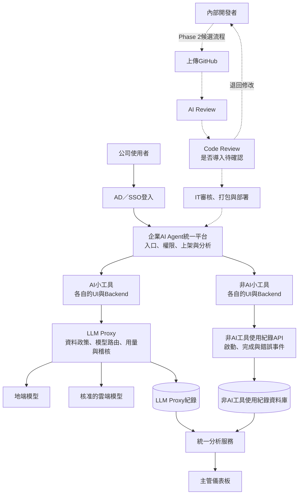
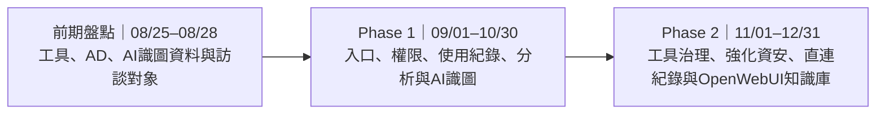

# 企業 AI Agent 統一管理平台 Proposal

> 高層會議更新版  
> 文件版本：v0.4（依 2026/08/21 會議結論調整）  
> 文件日期：2026/08/24

---

## 一、提案目的

目前公司內部已有多項 AI／非 AI 小工具，分散於不同部門、網址及系統。隨著工具持續增加，需要建立統一平台，讓使用者更容易找到及使用工具，也讓主管與IT能掌握權限、使用狀況及AI資料流向。

本提案建議建立「企業 AI Agent 統一管理平台」，作為：

- 員工使用小工具的統一入口。
- AD身分與角色權限的管理中心。
- AI模型流量與資料政策的治理中心。
- AI／非AI工具使用狀況的分析平台。
- 後續可擴充為內部同仁開發、送審及上架新工具的治理平台。

目前已完成新版 WorkHub 前端原型，將工具中心、部門分類、管理者儀表板及部分優先應用整合於同一介面，作為後續確認資訊架構、串接方式與分期範圍的具體參考。

### 初步規劃

| 項目 | 規劃方向 |
|---|---|
| 前期盤點 | 2026/08/25–2026/08/28，盤點現有工具、AD、AI識圖資料及訪談對象 |
| Phase 1 | 2026/09/01–2026/10/30，統一入口、權限、使用紀錄、分析及AI識圖工具 |
| Phase 2 | 2026/11/01–2026/12/31，工具治理、資安及OpenWebUI知識庫整合 |
| 建置期間 | Phase 1與Phase 2各約2個月，均包含測試、UAT、教育訓練及上線 |
| AI識圖使用規模 | 目前共7個廠區，各廠品保部門預估至少5位使用者；實際人數與角色待盤點 |
| 部署原則 | 地端優先，雲端模型依政策受控使用 |
| 新版介面 | [WorkHub 前端原型](http://localhost:3002/) |

---

## 二、平台重點

### 1. 統一入口與權限

- 使用者透過AD／SSO登入。
- 依部門、職務及角色顯示可使用的小工具。
- 每個工具保留自己原有的UI、後端及操作流程，平台不重做所有工具介面。

### 2. AI與非AI工具分流管理

- **AI工具：**工具後端將原本直連LLM的端點改接LLM Proxy，再由Proxy連接地端或核准的雲端模型。
- **非AI工具：**不經過LLM Proxy，使用事件寫入獨立的非AI工具使用紀錄資料庫。
- **主管分析：**兩邊資料由統一分析服務彙整，在同一個儀表板查看。

### 3. 內部工具上架與審查治理

- **Phase 1：**以既有工具的URL串接及入口整合為主，不建置新工具上架與Code Review流程。
- **Phase 2：**評估是否導入Code Review及正式工具上架治理；是否納入、審查責任與正式流程需於Phase 2規劃前確認。
- 候選流程為：`上傳GitHub → AI Review → IT審核 → 打包與部署 → 平台上架`。
- 若正式導入，治理範圍應包含人工審查、資安與品質標準、權限與資料流、核准／退回、版本及發布紀錄。

### 4. 使用與效益分析

- 目前在線人數與活躍使用者。
- 各工具的使用人數、使用次數及使用趨勢。
- AI與非AI工具使用分布。
- AI模型、Token、配額及地端／雲端模型使用比例。
- 工具效益指標與計算方式需透過各部門訪談確認，不直接以示意數值作為正式驗收依據。
- Phase 2需補強URL直連或書籤開啟工具時可能產生的使用紀錄缺口。

### 5. AI識圖與人工覆核

- AI識圖工具正式納入Phase 1，作為較具直接業務效益的優先應用。
- 目前規劃服務7個廠區，主要使用者為工程師及品檢員；各廠品保部門預估至少5位使用者，實際人數、角色與流程待盤點。
- 上傳工程圖後，由AI辨識指定欄位、規格及球標內容；開發前需取得原始工程圖檔及既定Excel輸出範本。
- 工程圖可能尺寸較大，前端需支援放大與縮小，方便使用者確認圖面細節。
- 右側只顯示一組AI辨識結果，不並列兩組數字，避免使用者混淆。
- 圖面旁提供鄰近的輸入或編輯框，讓使用者發現錯誤時可直接就近修正。
- 不要求逐筆點選「正確」，但流程結束前仍需進行最終人工確認。
- 人工確認後依客戶既定格式匯出Excel。
- AI原始辨識值與人工修正值均寫入資料庫，用於追蹤、稽核及計算模型準確率。
- 若識圖流程使用LLM，相關LLM請求須經LLM Proxy；純識圖模型與人工覆核事件則保留必要的模型及應用紀錄。

### 6. 知識管理與進階應用

- Phase 2以OpenWebUI既有能力為基礎，將全公司及各部門知識庫整合至統一平台。
- 依使用者部門及角色自動帶入可用知識庫，改善每次進入OpenWebUI都要手動選擇知識庫的問題。
- 建立跨部門知識庫，依部門及角色控制可使用的文件與資料。
- 一般使用者僅透過問答使用獲授權的知識，不直接查看或管理知識庫內容；管理者才可查看、新增及維護知識庫。
- 前端依角色隱藏或顯示知識庫管理功能。
- OpenWebUI已具備Prompt儲存功能，因此Prompt儲存不列為本次優先開發項目；Skill、MCP及快查能力亦待核心整合完成後再評估。
- 歷史資料助理支援Email、報價、合約、PO/RFQ及會議記錄的跨文件搜尋與來源引用。
- 業務情報及會議／文件助理強化資料整理、摘要、人工修改及輸出能力。
- 強化平台、URL串接、工具及知識庫整合相關的身分驗證、資料權限與資安控制。

> Phase 1以統一入口、AD權限、使用紀錄、分析及AI識圖為主；Phase 2聚焦工具治理、強化資安、URL直連紀錄補強及OpenWebUI知識庫整合。Code Review是否導入仍待確認。

---

## 三、平台架構

### 架構重點

1. 統一平台負責入口、權限、上架及分析。
2. 每個小工具仍使用自己的UI與Backend。
3. LLM Proxy建立在AI小工具與LLM之間，不是另一個平行的AI工具。
4. 非AI工具使用另一個資料庫記錄使用狀況。
5. 內部工具上架與Code Review屬Phase 2候選範圍，是否導入及正式流程仍待確認。
6. 以URL串接既有工具時，需補強書籤直連情境下的身分驗證與使用紀錄完整性。

---

## 四、目前已知的使用情境

| 工具 | 主要用途 | 初步整合方向 |
|---|---|---|
| CRM業務助理 | 查詢客戶、案件、機會及歷史互動 | 從統一入口開啟，保留原工具介面 |
| 歷史資料助理 | Email、報價、合約、PO/RFQ及會議記錄歸戶 | 提供跨文件搜尋、時間軸及來源文件 |
| RFQ／PO查詢助理 | 查詢RFQ與PO資料 | Phase 1先提供唯讀查詢，不寫回ERP |
| 採購報價匯整工具 | 客戶已完成的既有小工具，用於匯整不同供應商及格式的報價資料 | Phase 1由統一入口整合，保留原有UI、後端及功能，不納入本案重新開發 |
| 業務情報助理 | 整理市場、客戶、競品及新聞 | 保留資料來源及更新時間 |
| 會議／文件助理 | 整理會議記錄、交接摘要及拜訪紀錄 | 支援文件上傳、整理、人工修改及匯出 |

> 上述工具是否使用LLM，需於正式整合前確認；使用LLM者接入LLM Proxy，未使用LLM者接入非AI工具使用紀錄資料庫。

---

## 五、分階段建置

### 前期盤點：資訊與訪談對象確認（2026/08/25–2026/08/28）

- 盤點現有小工具的名稱、URL、用途、使用對象、維護者及串接需求。
- 盤點AD組織架構、角色及權限規則。
- 盤點AI識圖現況、原始工程圖、既定Excel格式、使用流程、廠區、使用者及資料留存需求。
- 列出各需求主題的訪談對象及安排訪談。
- 盤點各項Action item的實際負責人。

### Phase 1：統一入口、使用紀錄與AI識圖（2026/09/01–2026/10/30）

- 以URL方式串接目前既有小工具及OpenWebUI，建立統一使用入口；各工具保留原有UI、後端及操作流程。
- 串接AD／SSO，提供登入、身分辨識及角色權限管理。
- WorkHub依全公司／部門分類顯示有權限的工具，並提供搜尋及AI／非AI篩選。
- AI工具接入LLM Proxy；非AI工具寫入獨立使用紀錄資料庫。
- 建立使用紀錄與基礎分析功能；正式使用量、效益及分析指標透過訪談定義。
- 優先整合各部門既有小工具，包含客戶已完成的採購報價匯整工具；平台不重做原工具功能。
- AI識圖工具正式納入Phase 1，完成圖面縮放、單欄辨識結果、就近修正、人工確認及Excel匯出流程。
- AI識圖原始辨識值與人工修正值寫入資料庫，以支援準確率計算及後續追蹤。
- AI識圖開發前須取得原始工程圖檔及既定Excel輸出範本，並確認7個廠區的使用者人數、角色與實際操作流程。
- RFQ／PO維持唯讀查詢，不寫回ERP。
- 完成測試、UAT、教育訓練及正式上線。

### Phase 2：工具治理、強化資安與知識庫整合（2026/11/01–2026/12/31）

- 確認是否導入Code Review與正式工具上架治理；若導入，再定義審查人、標準、核准權限、退回修改及版本紀錄。
- 補強以URL串接工具時的使用紀錄缺口，處理使用者透過書籤直接開啟工具的身分驗證與統計方式。
- 強化平台、既有工具、URL串接及知識庫整合相關的資安與資料權限控制。
- 以OpenWebUI既有能力作為知識庫問答與管理基礎，再依企業需求整合至平台。
- 建立全公司共用及各部門專屬知識庫，串接AD與文件權限。
- 使用者進入OpenWebUI時，依身分自動帶入「全公司＋所屬部門」知識庫，不需每次手動選擇。
- 一般使用者僅能進行問答及查看獲授權的引用來源；知識庫內容、新增及維護功能只對管理者顯示。
- 建立知識庫文件上傳、索引、版本、啟用／停用、來源引用及維護權限。
- OpenWebUI已具備Prompt儲存功能，因此不列為本階段優先客製項目。
- 完成整合、資安、權限與使用紀錄完整性測試，以及UAT、教育訓練及正式上線。

---

## 六、新版使用者介面

[開啟 WorkHub 新版前端原型](http://localhost:3002/)

| 介面 | 新版呈現重點 | 分期定位 |
|---|---|---|
| WorkHub工具中心 | 依全公司／部門分類顯示有權限的工具，提供搜尋及AI／非AI篩選；畫面維持簡潔 | Phase 1核心 |
| 工具直接啟動 | 使用者登入後可直接進入具備權限的小工具，避免不必要的啟動摘要或中間頁面 | Phase 1核心 |
| 管理者儀表板 | 活躍使用者、採用率、工具執行次數、節省工時、使用趨勢及部門／工具明細 | Phase 1核心 |
| AI識圖工具 | 支援大圖縮放、單欄辨識結果、圖面旁就近修正、最終人工確認及既定格式Excel匯出 | Phase 1優先應用 |
| 企業／部門知識庫 | 依身分自動帶入全公司及所屬部門知識庫；一般使用者問答、管理者維護資料來源 | Phase 2，以OpenWebUI既有能力為基礎整合 |
| 工具治理介面 | Code Review及正式上架流程是否建置，依Phase 2確認結果決定 | Phase 2候選範圍 |

### 介面與正式範圍的界線

- Proposal包含前期盤點、Phase 1及Phase 2；新版3002介面只是用同一套導覽預先展示功能，不代表各階段合併交付。
- 畫面中的部門、工具名稱、人數、使用量及節省工時為提案示意，正式數值須由AD與實際使用紀錄產生。
- 知識庫問答與管理屬Phase 2；正式整合前仍需確認OpenWebUI可提供的介面、Knowledge Base ID、權限及自動選擇知識庫的可行方式。
- OpenWebUI已具備Prompt儲存功能，本案不優先重做相同功能。
- 新版原型目前著重一般使用者與主管介面；Code Review與開發者管理介面是否建置，於Phase 2規劃前確認。
- UI已出現不代表所有後端、資料庫、LLM Proxy或ERP／CRM串接均已完成，正式驗收仍依兩階段範圍辦理。

---

## 七、後續待確認事項

1. 各盤點與Action item的實際負責人為何？
2. 現有小工具的名稱、URL、用途、使用對象、維護者及串接需求為何？
3. AD組織架構、角色與權限規則為何？
4. 六個已知工具是否都納入Phase 1入口整合？若需排序，優先順序為何？
5. 採購報價匯整工具的既有網址、登入方式及AI／非AI類型為何？
6. 使用分析的採用率、使用量、節省工時、完成率及效益指標如何定義與計算？
7. URL直連或書籤開啟工具時，如何維持身分驗證及正確統計使用次數？
8. Phase 1、Phase 2是否包含驗收緩衝期？各階段的正式驗收標準為何？
9. AI識圖原始工程圖及既定Excel格式、欄位與範例由誰提供？
10. 7個廠區的品保使用者人數、工程師／品檢員角色及實際操作流程為何？
11. AI原始辨識值、人工修正值及準確率需要哪些資料庫欄位與計算規則？
12. 哪些客戶資料、合約、報價、文件或圖面禁止送往雲端？
13. Phase 2是否導入Code Review？審查人、標準、核准權限及發布負責單位為何？
14. OpenWebUI知識庫如何與平台整合？是否能依使用者身分自動選擇正確知識庫？
15. 各部門知識庫管理者由誰擔任？可新增、修改、停用哪些內容？
16. 主管是否僅能查看彙總使用與效益資料，不查看員工完整提問內容？

---

## 八、依8/21會議更新後的建議結論

以下方向作為後續規劃與規格討論的基準：

- **盤點方向：**2026/08/25–08/28先盤點工具、AD、AI識圖資料及訪談對象，再確認串接規格與責任人。
- **平台方向：**以URL整合既有工具與OpenWebUI，工具保留原介面；AI流量經LLM Proxy，非AI工具另行記錄使用事件。
- **Phase 1：**2026/09/01–10/30完成入口、AD權限、使用紀錄、分析及AI識圖；AI識圖採單欄結果、圖面縮放、就近修正、人工確認及Excel匯出。
- **Phase 2：**2026/11/01–12/31聚焦工具治理、強化資安、URL直連紀錄補強及OpenWebUI知識庫整合；Code Review是否導入仍待確認。
- **功能優先順序：**OpenWebUI已有Prompt儲存能力，本案不優先重做；先處理知識庫自動帶入及權限整合。
- **決策窗口：**確認Action item責任人、效益指標、驗收標準、AI識圖資料、書籤統計、資安及知識庫整合方式。

方向確認後，再依完整版Proposal進行技術規格、驗收條件及各工具串接方式的後續討論。

---

## 參考文件

- [WorkHub新版前端README](ai-agent-platform/AI_agent_platform/README.md)
- [WorkHub新版前端原型](http://localhost:3002/)
- [0812 AI Agent平台會議記錄](0812-會議記錄.md)
- [0818 AI Agent平台會議記錄](0818-會議記錄.md)
- [0821 AI Agent平台高層會議記錄](會議記錄/0821-會議記錄.md)
